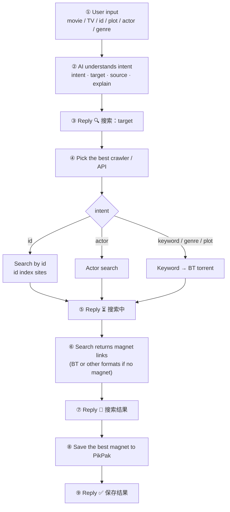

# tg-search-bot

A Python3 Telegram bot for searching video magnet links. It supports collecting and exporting records, auto-saving magnets to cloud drive, and is configurable for NSFW blocking and proxy access; it also integrates AI natural-language understanding to identify the user's intent, target, and data source directly from plain-language requests.

- Data sources: multiple public video / magnet index sites (wrapped by [`Jvav`](https://pypi.org/project/Jvav/))
- BT torrents: TorrentKitty (Chinese) + apibay (English), merged and de-duplicated
- Cache: SQLite (no Redis required)
- Cloud drive: Pikpak official OpenAPI
- AI: any OpenAI-compatible API with intent recognition and automatic search routing

## Features

- Search videos by id / actor / keyword, returning cover, rating, date, tags, actors and magnet links (HD / subtitle filtering supported)
- Fetch preview video, full video and screenshots
- Collect actors and ids, export records (`record.json`)
- Actor ranking, random high-rated / latest videos
- Auto-save the best magnet link to Pikpak (login token, direct offline task)
- AI natural-language search: understand id / actor / title / plot / genre and pick the best data source
- BT torrent search (Chinese + English engines) with paginated results
- Multi-turn follow-up: `换一批` / `下一页` / `上一页` / `保存第N个`
- Configurable NSFW switch and proxy access

## Core flow (AI natural-language search)

Search flow:

1. The user sends the resource or related info (movie / TV title, id, plot / dialogue, actor, genre)
2. The AI understands the target (infer a title from a plot, recommend by genre, etc.) and outputs `intent / target / source / explain`
3. Bot replies: `🔍 搜索：{target}`
4. The AI picks the best crawler / API (id → id index site, actor → actor search, others → keyword or BT)
5. Bot replies: `⏳ 搜索中 ...`
6. The crawler / API searches and returns magnet links (or other formats such as BT torrents when no magnet exists)
7. Bot replies: `📄 搜索结果`
8. The bot saves the best magnet link to the configured cloud drive (PikPak)
9. Bot replies: `✅ 保存结果：已提交离线任务到 PikPak`

> Without an AI API configured, it falls back to the original id detection + BT keyword search.



## Project structure

```
bot.py              Main program: config, logging, message/callback handlers, AI search flow
ai.py               AI intent client (OpenAI-compatible /chat/completions)
pikpak.py           Pikpak official OpenAPI client (login / refresh token, offline download)
database.py         Data layer: BotFileDb (JSON records) + BotCacheDb (SQLite cache)
requirements.txt    Dependencies
docker-compose.yml  One-click deployment
```

Config and data files are stored in `~/.tg_search_bot/`: `config.yaml` (main config), `record.json` (records), `cache.db` (cache), `pikpak_token.json` (Pikpak session), `log.txt` (logs).

## Usage

### 1. Configure

Edit `~/.tg_search_bot/config.yaml`:

```yaml
# required, your telegram chat id
tg_chat_id: 
# required, your telegram bot token
tg_bot_token: 
# required, global proxy, 1 yes | 0 no
use_proxy: 
# optional, proxy server address, required if use_proxy == 1 (e.g. http://127.0.0.1:7890)
proxy_addr: 
# required, enable nsfw or not, 1 yes | 0 no
enable_nsfw: 0
# optional, pikpak account (for auto saving magnets to pikpak via official api)
pikpak_username: 
pikpak_password: 
# optional, openai-compatible api config (for AI natural language search)
ai_base_url: 
ai_api_key: 
ai_model: 
```

### 2. Run

```sh
# Option 1: docker-compose
docker-compose up -d

# Option 2: run directly (Python >= 3.9)
pip install -r requirements.txt
python3 bot.py
```

### 3. Commands

| Command | Description |
| --- | --- |
| `/help` | View help |
| `/id <id>` | Search by id |
| `/star <name>` | Search actor |
| `/stars` | View collected actors |
| `/ids` | View collected ids |
| `/record` | Export records file |
| `/rank` | Actor ranking |
| `/nice` | Random high-rated video |
| `/new` | Random latest video |

Just send a movie title / keyword / id / plot / actor / genre and the AI will understand and search automatically.

### 4. Multi-turn follow-up

BT results are paginated with 5 items per page. You can reply:

- `换一批` / `下一页` / `还有吗` — next page
- `上一页` — previous page
- `保存第N个` (or `save N`) — save the N-th magnet to Pikpak

## Development

Python 3.9 is recommended, preferably in a virtual environment:

```sh
git clone https://github.com/akynazh/tg-search-bot.git
cd tg-search-bot
python3 -m venv .venv
source ./.venv/bin/activate
pip3 install -r requirements.txt
```

## Thanks

<a href="https://www.jetbrains.com/">
</a>

Thanks to JetBrains for their support to this project!
