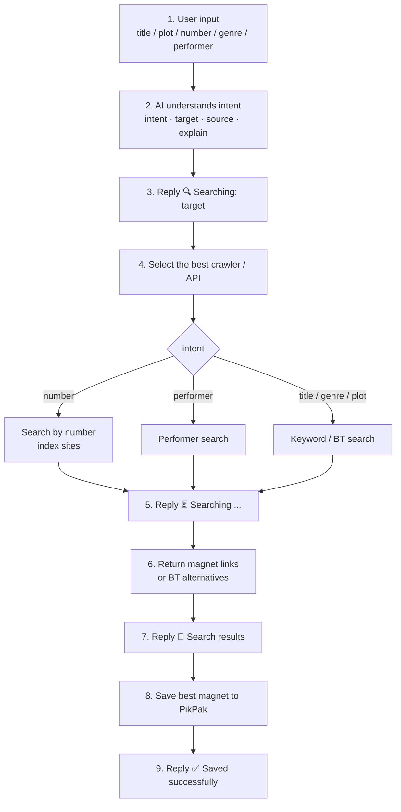

# tg-search-bot

[English](README.md)｜[中文](README.zh.md)

A Python 3 Telegram bot for searching video magnet links. It supports collection and export of records, automatic saving to cloud storage, configurable NSFW filtering, proxy support, and AI-powered natural-language understanding for automatic intent, target, and source detection from user input.

- Data sources: TorrentKitty (Chinese) + apibay (English) + video index APIs (Jvav)
- Cloud storage: PikPak official OpenAPI
- AI: any OpenAI-compatible API for intent recognition and automatic routing

## Features

- Search by title, keyword, number, plot, performer name, or genre
- Return cover art, rating, release date, tags, cast, and magnet links with optional HD / subtitle filtering
- Fetch preview videos, full videos, and screenshots
- Store and export records in `record.json`
- Random high-quality and latest picks
- Save the best magnet link to PikPak with direct offline download support
- AI natural-language search that understands intent and selects the best source automatically
- BT torrent search using multiple sources with paginated results
- Multi-turn follow-up: `next batch`, `next page`, `previous page`, `save item N`
- Configurable NSFW filter and proxy support

## Core flow

1. The user sends a resource request such as a movie title, TV show, number, plot summary, performer, or genre.
2. The AI interprets the request and returns `intent`, `target`, `source`, and `explain`.
3. The bot replies with `🔍 Searching: {target}`.
4. The AI chooses the best crawler or API for the request.
5. The bot replies with `⏳ Searching ...`.
6. The crawler/API returns magnet links or alternative BT results if no magnet is found.
7. The bot replies with `📄 Search results`.
8. The best magnet is saved to the configured PikPak account.
9. The bot replies with `✅ Saved successfully`.

> If no AI API is configured, the bot falls back to the original number detection and BT keyword search flow.



## Project structure

```
bot.py              Main program: config, logging, message handlers, AI flow
ai.py               AI intent client using OpenAI-compatible /chat/completions
pikpak.py           PikPak official OpenAPI client for login, token refresh, and offline download
database.py         Data layer: BotFileDb (JSON records) + BotCacheDb (SQLite cache)
requirements.txt    Dependencies
docker-compose.yml  One-click deployment
```

Runtime data is stored under `~/.tg_search_bot/`: `config.yaml`, `record.json`, `cache.db`, `pikpak_token.json`, and `log.txt`.

## Usage

### 1. Configure

Edit `~/.tg_search_bot/config.yaml`:

```yaml
# Required: Telegram chat ID
tg_chat_id:
# Required: Telegram bot token
tg_bot_token:
# Required: use global proxy, 1 = yes, 0 = no
use_proxy:
# Optional: proxy address, required when use_proxy is 1
proxy_addr:
# Required: enable NSFW content, 1 = yes, 0 = no
enable_nsfw: 0
# Optional: PikPak account for auto-saving magnets
pikpak_username:
pikpak_password:
# Optional: AI natural-language search via any OpenAI-compatible API
ai_base_url:
ai_api_key:
ai_model:
```

### 2. Run

```sh
# Option 1: Docker deployment
docker-compose up -d

# Option 2: run directly (Python 3.9+)
pip install -r requirements.txt
python3 bot.py
```

### 3. Commands

| Command | Description |
| --- | --- |
| `/help` | Show help |
| `/stars` | View collected performers |
| `/ids` | View collected numbers |
| `/record` | Export the records file |

Simply send a movie title, keyword, number, plot summary, performer name, or genre. The AI will understand and search automatically.

### 4. Multi-turn follow-up

BT search results are paginated in groups of 5. You can continue with:

- `next batch` / `next page` / `more` — show the next page
- `previous page` — show the previous page
- `save item N` or `save N` — save the N-th magnet to PikPak

## Development

Python 3.9+ is recommended, preferably with a virtual environment:

```sh
git clone https://github.com/akynazh/tg-search-bot.git
cd tg-search-bot
python3 -m venv .venv
source ./.venv/bin/activate
pip3 install -r requirements.txt
```

## Thanks

<a href="https://www.jetbrains.com/">
</a>

Thanks to JetBrains for supporting this project.
