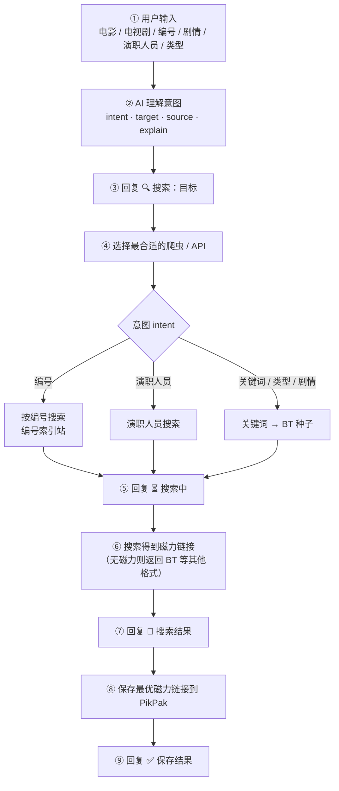

# tg-search-bot

一个基于 Python3 的 Telegram 资源搜索机器人：搜索各类视频磁力链接，支持收藏、导出记录、自动保存到网盘，可配置 NSFW 开关与代理上网；同时集成 AI 自然语言理解能力，可直接根据用户自然语言意图自动识别搜索目标、类型与数据源。

- 数据来源：多个公开影视 / 磁力索引站（由 [`Jvav`](https://pypi.org/project/Jvav/) 封装）
- BT 种子：TorrentKitty（中文）+ apibay（英文），合并去重
- 网盘：Pikpak 官方 OpenAPI
- AI：任意 OpenAI 兼容接口，支持意图识别与自动搜索

## 功能

- 按编号 / 演职人员 / 关键词搜索影片，返回封面、评分、日期、标签、演职人员及磁力链接（支持 HD / 字幕等过滤）
- 获取预览视频、完整视频与影片截图
- 收藏与导出记录（`record.json`）
- 排行榜、随机高分 / 最新影片
- 自动把最优磁力链接保存到 Pikpak（登录 token 直传离线任务）
- AI 自然语言理解搜索：识别编号 / 演职人员 / 片名 / 剧情 / 类型并自动选择数据源
- BT 种子搜索（中文 / 英文双引擎），结果分页
- 多轮追问：`换一批` / `下一页` / `上一页` / `保存第N个`
- 可配置 NSFW 开关与代理上网

## 核心流程（AI 自然语言搜索）

搜索流程：

1. 用户输入想要的资源 / 资源相关信息（电影、电视剧名称、影片编号、剧情 / 对话、演职人员、影片类型）
2. AI 根据输入理解用户目标（根据剧情推测片名、根据类型推荐等），输出 `intent / target / source / explain`
3. 机器人回复：`🔍 搜索：{目标}`
4. AI 选择最合适的爬虫 / API 进行搜索（编号 → 编号索引站，演职人员 → 演职人员搜索，其余 → 关键词或 BT）
5. 机器人回复：`⏳ 搜索中 ...`
6. 爬虫 / API 搜索得到磁力链接（没有磁力时返回 BT 种子等其他格式内容）
7. 机器人回复：`📄 搜索结果`
8. 程序将最优磁力链接保存到已配置的网盘（PikPak）
9. 机器人回复：`✅ 保存结果：已提交离线任务到 PikPak`

> 未配置 AI 接口时自动回退到原来的编号识别 + BT 关键词搜索逻辑。



## 目录结构

```
bot.py              主程序：配置、日志、消息 / 回调处理、AI 搜索流程
ai.py               AI 意图理解客户端（OpenAI 兼容 /chat/completions）
pikpak.py           Pikpak 官方 OpenAPI 客户端（登录 / 刷新 token、离线下载）
database.py         数据层：BotFileDb（JSON 收藏）+ BotCacheDb（SQLite 缓存）
requirements.txt    依赖
docker-compose.yml  一键部署
```

配置与数据文件存放于 `~/.tg_search_bot/`：`config.yaml`（主配置）、`record.json`（收藏）、`cache.db`（缓存）、`pikpak_token.json`（Pikpak 登录态）、`log.txt`（日志）。

## 使用

### 1. 配置

编辑 `~/.tg_search_bot/config.yaml`：

```yaml
# 必填，你的 Telegram chat id
tg_chat_id: 
# 必填，你的 Telegram bot token
tg_bot_token: 
# 必填，是否启用全局代理，1 是 / 0 否
use_proxy: 
# 可选，代理地址（use_proxy 为 1 时必填），如 http://127.0.0.1:7890
proxy_addr: 
# 必填，是否开启 NSFW 内容，1 是 / 0 否
enable_nsfw: 0
# 可选，Pikpak 账号（用于自动保存磁力到网盘，官方 API）
pikpak_username: 
pikpak_password: 
# 可选，AI 自然语言搜索（任意 OpenAI 兼容接口）
ai_base_url: 
ai_api_key: 
ai_model: 
```

### 2. 运行

```sh
# 方式一：Docker 一键部署
docker-compose up -d

# 方式二：直接运行（Python >= 3.9）
pip install -r requirements.txt
python3 bot.py
```

### 3. 命令

| 命令 | 说明 |
| --- | --- |
| `/help` | 查看帮助 |
| `/id 编号` | 按编号搜索 |
| `/star 演职人员名` | 搜索演职人员 |
| `/stars` | 查看已收藏演职人员 |
| `/ids` | 查看已收藏编号 |
| `/record` | 导出收藏记录文件 |
| `/rank` | 查看演职人员排行 |
| `/nice` | 随机一部高分影片 |
| `/new` | 随机一部最新影片 |

直接发送电影名 / 关键词 / 编号 / 剧情 / 演职人员 / 类型即可，AI 会自动理解并搜索。

### 4. 多轮追问

BT 搜索结果每页 5 条，可继续回复：

- `换一批` / `下一页` / `还有吗` — 下一页
- `上一页` — 上一页
- `保存第N个`（或 `save N`）— 把第 N 条磁力保存到 Pikpak

## 开发

推荐使用 Python 3.9，并建议使用虚拟环境：

```sh
git clone https://github.com/akynazh/tg-search-bot.git
cd tg-search-bot
python3 -m venv .venv
source ./.venv/bin/activate
pip3 install -r requirements.txt
```

## 致谢

<a href="https://www.jetbrains.com/">
</a>

Thanks to JetBrains for their support to this project!
